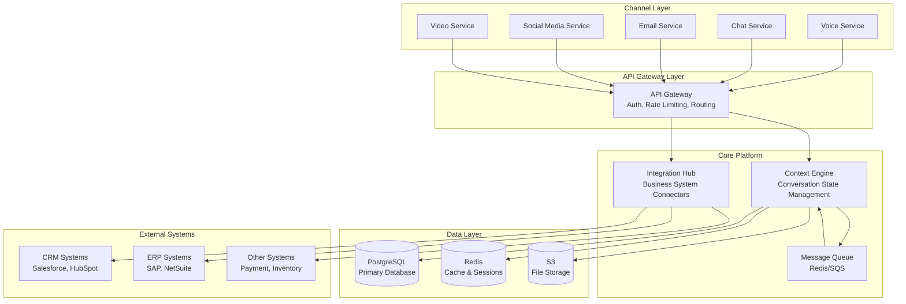
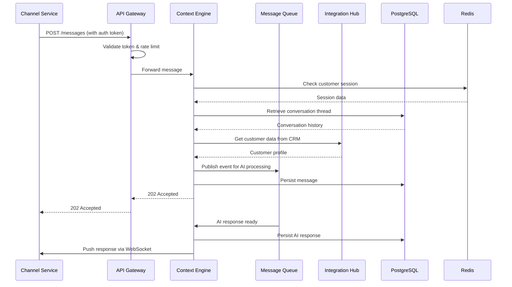

# Design Document: Core Platform Foundation

## Overview

The Core Platform Foundation provides the architectural backbone for the Multi-Modal Customer Service AI Platform. It implements a microservices architecture with three primary components:

1. **Context Engine**: Manages unified conversation state and customer context across all channels
2. **Integration Hub**: Provides standardized access to external business systems (CRM, ERP, etc.)
3. **API Gateway**: Handles authentication, rate limiting, and request routing

The design follows event-driven architecture principles, enabling real-time processing, horizontal scalability, and loose coupling between components. All services communicate through well-defined APIs and message queues, allowing independent deployment and scaling.

### Key Design Principles

- **Channel Agnostic**: Core platform has no knowledge of channel-specific protocols
- **Event-Driven**: Asynchronous processing for scalability and resilience
- **Multi-Tenant**: Complete data isolation with tenant-specific configuration
- **Security First**: Encryption, audit logging, and compliance built-in from day one
- **Cloud Native**: Designed for containerized deployment with auto-scaling

## Architecture

### High-Level Architecture Diagram



### Component Interaction Flow



## Components and Interfaces

### 1. Context Engine

The Context Engine is the heart of the platform, responsible for managing all conversation state and customer context.

#### Responsibilities

- Store and retrieve conversation threads across all channels
- Manage customer identity resolution and linking
- Coordinate message routing between channels and AI/human agents
- Maintain session state for active conversations
- Enforce data retention and privacy policies

#### Core Modules

**1.1 Conversation Manager**

```python
class ConversationManager:
    """
    Manages conversation threads and message persistence.
    """

    def create_conversation(
        self,
        customer_id: str,
        channel: ChannelType,
        tenant_id: str
    ) -> Conversation:
        """
        Create a new conversation or retrieve existing active conversation.

        Args:
            customer_id: Unique customer identifier
            channel: Channel where conversation initiated
            tenant_id: Tenant/customer organization ID

        Returns:
            Conversation object with unique ID and metadata
        """
        pass

    def add_message(
        self,
        conversation_id: str,
        message: Message
    ) -> None:
        """
        Add a message to a conversation thread.

        Args:
            conversation_id: Target conversation ID
            message: Message object with content, sender, timestamp

        Raises:
            ConversationNotFoundError: If conversation doesn't exist
            ValidationError: If message fails schema validation
        """
        pass

    def get_conversation_history(
        self,
        conversation_id: str,
        limit: int = 100,
        before_timestamp: Optional[datetime] = None
    ) -> List[Message]:
        """
        Retrieve conversation history with pagination.

        Args:
            conversation_id: Target conversation ID
            limit: Maximum messages to return
            before_timestamp: Return messages before this timestamp

        Returns:
            List of messages in chronological order
        """
        pass

    def get_customer_conversations(
        self,
        customer_id: str,
        tenant_id: str,
        active_only: bool = False
    ) -> List[Conversation]:
        """
        Get all conversations for a customer across all channels.

        Args:
            customer_id: Customer identifier
            tenant_id: Tenant ID for data isolation
            active_only: Return only active conversations

        Returns:
            List of conversation objects
        """
        pass
```

**1.2 Identity Resolver**

```python
class IdentityResolver:
    """
    Resolves customer identity across channels and sessions.
    """

    def resolve_identity(
        self,
        identifiers: Dict[str, str],
        tenant_id: str
    ) -> Optional[str]:
        """
        Resolve multiple identifiers to a single customer ID.

        Args:
            identifiers: Dict of identifier types to values
                        e.g., {"email": "user@example.com", "phone": "+1234567890"}
            tenant_id: Tenant ID for data isolation

        Returns:
            Customer ID if found, None if no match
        """
        pass

    def create_customer(
        self,
        identifiers: Dict[str, str],
        tenant_id: str,
        metadata: Optional[Dict] = None
    ) -> str:
        """
        Create a new customer identity.

        Args:
            identifiers: Primary identifiers for the customer
            tenant_id: Tenant ID
            metadata: Additional customer metadata

        Returns:
            New customer ID
        """
        pass

    def link_identifier(
        self,
        customer_id: str,
        identifier_type: str,
        identifier_value: str
    ) -> None:
        """
        Link a new identifier to an existing customer.

        Args:
            customer_id: Target customer ID
            identifier_type: Type of identifier (email, phone, etc.)
            identifier_value: Identifier value

        Raises:
            CustomerNotFoundError: If customer doesn't exist
            DuplicateIdentifierError: If identifier already linked to another customer
        """
        pass
```

**1.3 Context Handoff Manager**

```python
class ContextHandoffManager:
    """
    Manages context transfer during channel switches and escalations.
    """

    def prepare_handoff(
        self,
        conversation_id: str,
        target_channel: ChannelType,
        handoff_reason: str
    ) -> HandoffPackage:
        """
        Prepare complete context for handoff to another channel or agent.

        Args:
            conversation_id: Source conversation ID
            target_channel: Destination channel
            handoff_reason: Reason for handoff (escalation, channel switch, etc.)

        Returns:
            HandoffPackage containing conversation history, customer data,
            AI actions taken, and handoff metadata
        """
        pass

    def execute_handoff(
        self,
        handoff_package: HandoffPackage,
        target_agent_id: Optional[str] = None
    ) -> str:
        """
        Execute handoff and create new conversation in target channel.

        Args:
            handoff_package: Prepared handoff context
            target_agent_id: Specific agent ID if routing to human

        Returns:
            New conversation ID in target channel
        """
        pass
```

**1.4 Deduplication Manager**

```python
class DeduplicationManager:
    """
    Detects and prevents duplicate records across customers, conversations, and messages.
    """

    def detect_duplicate_customers(
        self,
        identifiers: Dict[str, str],
        tenant_id: str,
        fuzzy_threshold: float = 0.85
    ) -> List[str]:
        """
        Detect potential duplicate customers using fuzzy matching.

        Args:
            identifiers: Customer identifiers to check (email, phone, account_id)
            tenant_id: Tenant ID for data isolation
            fuzzy_threshold: Similarity threshold for fuzzy matching (0.0-1.0)

        Returns:
            List of customer IDs that are potential duplicates
        """
        pass

    def detect_duplicate_messages(
        self,
        conversation_id: str,
        message_id: str,
        timestamp: datetime
    ) -> Optional[str]:
        """
        Check if a message already exists to prevent duplicates.

        Args:
            conversation_id: Conversation ID
            message_id: Message ID from source system
            timestamp: Message timestamp

        Returns:
            Existing message ID if duplicate found, None otherwise
        """
        pass

    def detect_duplicate_conversations(
        self,
        customer_id: str,
        channel: ChannelType,
        tenant_id: str,
        time_window_hours: int = 24
    ) -> List[str]:
        """
        Detect duplicate conversations for same customer/channel within time window.

        Args:
            customer_id: Customer ID
            channel: Channel type
            tenant_id: Tenant ID
            time_window_hours: Time window to check for duplicates

        Returns:
            List of conversation IDs that are potential duplicates
        """
        pass

    def merge_customers(
        self,
        primary_customer_id: str,
        duplicate_customer_ids: List[str],
        tenant_id: str
    ) -> Dict:
        """
        Merge duplicate customer records into primary customer.

        Args:
            primary_customer_id: Customer ID to keep
            duplicate_customer_ids: Customer IDs to merge into primary
            tenant_id: Tenant ID for data isolation

        Returns:
            Merge result with statistics and audit trail reference
        """
        pass

    def merge_conversations(
        self,
        primary_conversation_id: str,
        duplicate_conversation_ids: List[str]
    ) -> Dict:
        """
        Merge duplicate conversations into primary conversation.

        Args:
            primary_conversation_id: Conversation ID to keep
            duplicate_conversation_ids: Conversation IDs to merge

        Returns:
            Merge result with message count and audit trail reference
        """
        pass

    def get_deduplication_report(
        self,
        tenant_id: str,
        entity_type: str = "all"
    ) -> Dict:
        """
        Generate report of detected duplicates.

        Args:
            tenant_id: Tenant ID
            entity_type: Type of entity to report on (customers, conversations, messages, all)

        Returns:
            Report with duplicate counts and suggestions
        """
        pass
```

#### API Endpoints

**POST /api/v1/conversations**

- Create new conversation
- Request: `{ customer_id, channel, tenant_id, metadata }`
- Response: `{ conversation_id, created_at, status }`

**POST /api/v1/conversations/{conversation_id}/messages**

- Add message to conversation
- Request: `{ sender_type, sender_id, content, attachments, metadata }`
- Response: `{ message_id, timestamp, status }`

**GET /api/v1/conversations/{conversation_id}**

- Retrieve conversation details and history
- Query params: `limit`, `before_timestamp`
- Response: `{ conversation, messages[], customer_data }`

**GET /api/v1/customers/{customer_id}/conversations**

- Get all conversations for a customer
- Query params: `active_only`, `channel`, `limit`
- Response: `{ conversations[], total_count }`

**POST /api/v1/handoffs**

- Initiate context handoff
- Request: `{ conversation_id, target_channel, target_agent_id, reason }`
- Response: `{ handoff_id, new_conversation_id, status }`

**GET /api/v1/deduplication/report**

- Get deduplication report showing detected duplicates
- Query params: `tenant_id`, `entity_type` (customers, conversations, messages, all)
- Response: `{ duplicates: { customers: [], conversations: [], messages: [] }, suggestions: [] }`

**POST /api/v1/deduplication/merge**

- Merge duplicate records
- Request: `{ tenant_id, entity_type, primary_id, duplicate_ids[] }`
- Response: `{ success, merged_count, audit_trail_id }`

**GET /api/v1/deduplication/suggestions**

- Get merge suggestions based on fuzzy matching
- Query params: `tenant_id`, `entity_type`, `threshold`
- Response: `{ suggestions: [{ primary_id, duplicates: [], confidence_score }] }`

### 2. Integration Hub

The Integration Hub provides a unified interface for accessing external business systems.

#### Responsibilities

- Manage connections to CRM, ERP, and other business systems
- Provide standardized API for data retrieval and updates
- Handle authentication and credential management for external systems
- Cache frequently accessed data to reduce external API calls
- Log all integration activity for audit purposes

#### Core Modules

**2.1 Connector Registry**

```python
class ConnectorRegistry:
    """
    Registry of available business system connectors.
    """

    def register_connector(
        self,
        connector_type: str,
        connector_class: Type[BaseConnector],
        config_schema: Dict
    ) -> None:
        """
        Register a new connector type.

        Args:
            connector_type: Unique identifier (e.g., "salesforce", "hubspot")
            connector_class: Connector implementation class
            config_schema: JSON schema for connector configuration
        """
        pass

    def get_connector(
        self,
        tenant_id: str,
        connector_type: str
    ) -> BaseConnector:
        """
        Get configured connector instance for a tenant.

        Args:
            tenant_id: Tenant ID
            connector_type: Type of connector to retrieve

        Returns:
            Configured connector instance

        Raises:
            ConnectorNotConfiguredError: If connector not set up for tenant
        """
        pass
```

**2.2 Base Connector Interface**

```python
class BaseConnector(ABC):
    """
    Abstract base class for all business system connectors.
    """

    @abstractmethod
    def authenticate(self, credentials: Dict) -> bool:
        """Authenticate with the external system."""
        pass

    @abstractmethod
    def get_customer(self, customer_id: str) -> Dict:
        """Retrieve customer data from external system."""
        pass

    @abstractmethod
    def update_customer(self, customer_id: str, data: Dict) -> bool:
        """Update customer data in external system."""
        pass

    @abstractmethod
    def create_ticket(self, ticket_data: Dict) -> str:
        """Create a support ticket in external system."""
        pass

    @abstractmethod
    def get_orders(self, customer_id: str, limit: int = 10) -> List[Dict]:
        """Retrieve customer orders from external system."""
        pass

    @abstractmethod
    def health_check(self) -> bool:
        """Check if connection to external system is healthy."""
        pass
```

**2.3 CRM Connectors**

```python
class SalesforceConnector(BaseConnector):
    """
    Connector for Salesforce CRM.
    Uses Salesforce REST API and OAuth 2.0 authentication.
    """

    def __init__(self, config: Dict):
        self.instance_url = config["instance_url"]
        self.client_id = config["client_id"]
        self.client_secret = config["client_secret"]
        self.access_token = None

    def authenticate(self, credentials: Dict) -> bool:
        """Authenticate using OAuth 2.0 client credentials flow."""
        # Implementation details
        pass

    def get_customer(self, customer_id: str) -> Dict:
        """
        Retrieve customer from Salesforce Contact or Account object.
        Maps Salesforce fields to canonical customer schema.
        """
        # Implementation details
        pass

class HubSpotConnector(BaseConnector):
    """
    Connector for HubSpot CRM.
    Uses HubSpot API v3 and API key authentication.
    """

    def __init__(self, config: Dict):
        self.api_key = config["api_key"]
        self.base_url = "https://api.hubapi.com"

    def authenticate(self, credentials: Dict) -> bool:
        """Validate API key with HubSpot."""
        # Implementation details
        pass

    def get_customer(self, customer_id: str) -> Dict:
        """
        Retrieve customer from HubSpot Contacts API.
        Maps HubSpot properties to canonical customer schema.
        """
        # Implementation details
        pass
```

**2.4 Integration Cache**

```python
class IntegrationCache:
    """
    Caches data from external systems to reduce API calls.
    """

    def __init__(self, redis_client: Redis):
        self.redis = redis_client
        self.default_ttl = 300  # 5 minutes

    def get(
        self,
        cache_key: str,
        fetch_func: Callable,
        ttl: Optional[int] = None
    ) -> Any:
        """
        Get data from cache or fetch from source if not cached.

        Args:
            cache_key: Unique cache key
            fetch_func: Function to call if cache miss
            ttl: Time to live in seconds

        Returns:
            Cached or freshly fetched data
        """
        cached = self.redis.get(cache_key)
        if cached:
            return json.loads(cached)

        data = fetch_func()
        self.redis.setex(
            cache_key,
            ttl or self.default_ttl,
            json.dumps(data)
        )
        return data

    def invalidate(self, cache_key: str) -> None:
        """Invalidate a cache entry."""
        self.redis.delete(cache_key)
```

#### API Endpoints

**GET /api/v1/integrations/customer/{customer_id}**

- Retrieve customer data from configured CRM
- Query params: `tenant_id`, `include_orders`, `include_tickets`
- Response: `{ customer_data, orders[], tickets[] }`

**POST /api/v1/integrations/customer/{customer_id}**

- Update customer data in CRM
- Request: `{ tenant_id, updates: {...} }`
- Response: `{ success, updated_fields[] }`

**POST /api/v1/integrations/tickets**

- Create support ticket in external system
- Request: `{ tenant_id, customer_id, subject, description, priority }`
- Response: `{ ticket_id, external_ticket_id, created_at }`

**GET /api/v1/integrations/health**

- Check health of all configured integrations
- Query params: `tenant_id`
- Response: `{ connectors: [{ type, status, last_check }] }`

### 3. API Gateway

The API Gateway handles authentication, rate limiting, and request routing.

#### Responsibilities

- Authenticate all incoming requests
- Enforce rate limits per tenant
- Route requests to appropriate backend services
- Provide API versioning support
- Log all API requests for audit and analytics

#### Core Modules

**3.1 Authentication Middleware**

```python
class AuthenticationMiddleware:
    """
    Validates API keys and OAuth tokens.
    """

    def authenticate_request(self, request: Request) -> Optional[AuthContext]:
        """
        Authenticate incoming request.

        Args:
            request: HTTP request object

        Returns:
            AuthContext with tenant_id and permissions if valid,
            None if authentication fails
        """
        auth_header = request.headers.get("Authorization")
        if not auth_header:
            return None

        if auth_header.startswith("Bearer "):
            return self._validate_oauth_token(auth_header[7:])
        elif auth_header.startswith("ApiKey "):
            return self._validate_api_key(auth_header[7:])

        return None

    def _validate_api_key(self, api_key: str) -> Optional[AuthContext]:
        """Validate API key and return associated tenant context."""
        # Implementation details
        pass

    def _validate_oauth_token(self, token: str) -> Optional[AuthContext]:
        """Validate OAuth 2.0 token and return associated context."""
        # Implementation details
        pass
```

**3.2 Rate Limiter**

```python
class RateLimiter:
    """
    Enforces rate limits per tenant using token bucket algorithm.
    """

    def __init__(self, redis_client: Redis):
        self.redis = redis_client

    def check_rate_limit(
        self,
        tenant_id: str,
        endpoint: str
    ) -> Tuple[bool, Dict]:
        """
        Check if request is within rate limit.

        Args:
            tenant_id: Tenant making the request
            endpoint: API endpoint being accessed

        Returns:
            Tuple of (allowed: bool, limit_info: dict)
            limit_info contains: limit, remaining, reset_time
        """
        key = f"rate_limit:{tenant_id}:{endpoint}"
        limit = self._get_tenant_limit(tenant_id, endpoint)

        current = self.redis.get(key)
        if current is None:
            self.redis.setex(key, 60, 1)
            return True, {
                "limit": limit,
                "remaining": limit - 1,
                "reset_time": time.time() + 60
            }

        current = int(current)
        if current >= limit:
            return False, {
                "limit": limit,
                "remaining": 0,
                "reset_time": self.redis.ttl(key) + time.time()
            }

        self.redis.incr(key)
        return True, {
            "limit": limit,
            "remaining": limit - current - 1,
            "reset_time": self.redis.ttl(key) + time.time()
        }

    def _get_tenant_limit(self, tenant_id: str, endpoint: str) -> int:
        """Get rate limit for tenant based on subscription tier."""
        # Implementation details
        pass
```

**3.3 Request Router**

```python
class RequestRouter:
    """
    Routes requests to appropriate backend services.
    """

    def route_request(self, request: Request) -> Response:
        """
        Route request to backend service based on path and method.

        Args:
            request: HTTP request object

        Returns:
            HTTP response from backend service
        """
        if request.path.startswith("/api/v1/conversations"):
            return self._forward_to_context_engine(request)
        elif request.path.startswith("/api/v1/integrations"):
            return self._forward_to_integration_hub(request)
        elif request.path.startswith("/api/v1/customers"):
            return self._forward_to_context_engine(request)
        else:
            return Response(status=404, body={"error": "Not found"})

    def _forward_to_context_engine(self, request: Request) -> Response:
        """Forward request to Context Engine service."""
        # Implementation details
        pass

    def _forward_to_integration_hub(self, request: Request) -> Response:
        """Forward request to Integration Hub service."""
        # Implementation details
        pass
```

## Data Models

### Database Schema

#### Customers Table

```sql
CREATE TABLE customers (
    id UUID PRIMARY KEY DEFAULT gen_random_uuid(),
    tenant_id UUID NOT NULL,
    external_id VARCHAR(255),  -- ID from CRM system
    created_at TIMESTAMP NOT NULL DEFAULT NOW(),
    updated_at TIMESTAMP NOT NULL DEFAULT NOW(),
    metadata JSONB,

    CONSTRAINT fk_tenant FOREIGN KEY (tenant_id) REFERENCES tenants(id),
    CONSTRAINT unique_external_id UNIQUE (tenant_id, external_id)
);

CREATE INDEX idx_customers_tenant ON customers(tenant_id);
CREATE INDEX idx_customers_external_id ON customers(tenant_id, external_id);
```

#### Customer Identifiers Table

```sql
CREATE TABLE customer_identifiers (
    id UUID PRIMARY KEY DEFAULT gen_random_uuid(),
    customer_id UUID NOT NULL,
    identifier_type VARCHAR(50) NOT NULL,  -- email, phone, account_id, etc.
    identifier_value VARCHAR(255) NOT NULL,
    verified BOOLEAN DEFAULT FALSE,
    created_at TIMESTAMP NOT NULL DEFAULT NOW(),

    CONSTRAINT fk_customer FOREIGN KEY (customer_id) REFERENCES customers(id) ON DELETE CASCADE,
    CONSTRAINT unique_identifier UNIQUE (identifier_type, identifier_value)
);

CREATE INDEX idx_identifiers_customer ON customer_identifiers(customer_id);
CREATE INDEX idx_identifiers_lookup ON customer_identifiers(identifier_type, identifier_value);
```

#### Conversations Table

```sql
CREATE TABLE conversations (
    id UUID PRIMARY KEY DEFAULT gen_random_uuid(),
    customer_id UUID NOT NULL,
    tenant_id UUID NOT NULL,
    channel VARCHAR(50) NOT NULL,  -- voice, chat, email, social, video
    status VARCHAR(50) NOT NULL DEFAULT 'active',  -- active, closed, escalated
    started_at TIMESTAMP NOT NULL DEFAULT NOW(),
    ended_at TIMESTAMP,
    metadata JSONB,

    CONSTRAINT fk_customer FOREIGN KEY (customer_id) REFERENCES customers(id),
    CONSTRAINT fk_tenant FOREIGN KEY (tenant_id) REFERENCES tenants(id)
);

CREATE INDEX idx_conversations_customer ON conversations(customer_id);
CREATE INDEX idx_conversations_tenant ON conversations(tenant_id);
CREATE INDEX idx_conversations_status ON conversations(status) WHERE status = 'active';
CREATE INDEX idx_conversations_started ON conversations(started_at DESC);
```

#### Messages Table

```sql
CREATE TABLE messages (
    id UUID PRIMARY KEY DEFAULT gen_random_uuid(),
    conversation_id UUID NOT NULL,
    sender_type VARCHAR(50) NOT NULL,  -- customer, ai_agent, human_agent, system
    sender_id VARCHAR(255),
    content TEXT NOT NULL,
    content_type VARCHAR(50) DEFAULT 'text',  -- text, image, video, file
    timestamp TIMESTAMP NOT NULL DEFAULT NOW(),
    metadata JSONB,

    CONSTRAINT fk_conversation FOREIGN KEY (conversation_id) REFERENCES conversations(id) ON DELETE CASCADE
);

CREATE INDEX idx_messages_conversation ON messages(conversation_id, timestamp DESC);
CREATE INDEX idx_messages_timestamp ON messages(timestamp DESC);

-- Partition messages table by month for performance
CREATE TABLE messages_2026_01 PARTITION OF messages
    FOR VALUES FROM ('2026-01-01') TO ('2026-02-01');
```

#### Handoffs Table

```sql
CREATE TABLE handoffs (
    id UUID PRIMARY KEY DEFAULT gen_random_uuid(),
    source_conversation_id UUID NOT NULL,
    target_conversation_id UUID,
    source_channel VARCHAR(50) NOT NULL,
    target_channel VARCHAR(50) NOT NULL,
    handoff_reason VARCHAR(255) NOT NULL,
    handoff_type VARCHAR(50) NOT NULL,  -- channel_switch, escalation, transfer
    initiated_at TIMESTAMP NOT NULL DEFAULT NOW(),
    completed_at TIMESTAMP,
    status VARCHAR(50) NOT NULL DEFAULT 'pending',  -- pending, completed, failed
    context_package JSONB NOT NULL,

    CONSTRAINT fk_source_conversation FOREIGN KEY (source_conversation_id) REFERENCES conversations(id),
    CONSTRAINT fk_target_conversation FOREIGN KEY (target_conversation_id) REFERENCES conversations(id)
);

CREATE INDEX idx_handoffs_source ON handoffs(source_conversation_id);
CREATE INDEX idx_handoffs_target ON handoffs(target_conversation_id);
CREATE INDEX idx_handoffs_status ON handoffs(status) WHERE status = 'pending';
```

#### Audit Log Table

```sql
CREATE TABLE audit_log (
    id UUID PRIMARY KEY DEFAULT gen_random_uuid(),
    tenant_id UUID NOT NULL,
    event_type VARCHAR(100) NOT NULL,  -- data_access, data_modification, api_call, etc.
    actor_type VARCHAR(50) NOT NULL,  -- user, system, api_client
    actor_id VARCHAR(255) NOT NULL,
    resource_type VARCHAR(100) NOT NULL,  -- customer, conversation, message, etc.
    resource_id UUID NOT NULL,
    action VARCHAR(100) NOT NULL,  -- read, create, update, delete
    timestamp TIMESTAMP NOT NULL DEFAULT NOW(),
    ip_address INET,
    user_agent TEXT,
    request_data JSONB,
    response_data JSONB,

    CONSTRAINT fk_tenant FOREIGN KEY (tenant_id) REFERENCES tenants(id)
);

CREATE INDEX idx_audit_tenant ON audit_log(tenant_id, timestamp DESC);
CREATE INDEX idx_audit_resource ON audit_log(resource_type, resource_id);
CREATE INDEX idx_audit_actor ON audit_log(actor_type, actor_id);

-- Partition audit log by month for performance and retention management
CREATE TABLE audit_log_2026_01 PARTITION OF audit_log
    FOR VALUES FROM ('2026-01-01') TO ('2026-02-01');
```

#### Tenants Table

```sql
CREATE TABLE tenants (
    id UUID PRIMARY KEY DEFAULT gen_random_uuid(),
    name VARCHAR(255) NOT NULL,
    subscription_tier VARCHAR(50) NOT NULL,  -- free, basic, professional, enterprise
    data_residency VARCHAR(50) NOT NULL,  -- us, eu, ca, au, etc.
    retention_days INTEGER NOT NULL DEFAULT 14,
    rate_limit_per_minute INTEGER NOT NULL DEFAULT 1000,
    created_at TIMESTAMP NOT NULL DEFAULT NOW(),
    updated_at TIMESTAMP NOT NULL DEFAULT NOW(),
    config JSONB,

    CONSTRAINT unique_tenant_name UNIQUE (name)
);

CREATE INDEX idx_tenants_tier ON tenants(subscription_tier);
```

### Data Transfer Objects (DTOs)

```python
from dataclasses import dataclass
from datetime import datetime
from typing import Optional, List, Dict
from enum import Enum

class ChannelType(Enum):
    VOICE = "voice"
    CHAT = "chat"
    EMAIL = "email"
    SOCIAL = "social"
    VIDEO = "video"

class SenderType(Enum):
    CUSTOMER = "customer"
    AI_AGENT = "ai_agent"
    HUMAN_AGENT = "human_agent"
    SYSTEM = "system"

@dataclass
class Message:
    id: str
    conversation_id: str
    sender_type: SenderType
    sender_id: Optional[str]
    content: str
    content_type: str
    timestamp: datetime
    metadata: Optional[Dict] = None

@dataclass
class Conversation:
    id: str
    customer_id: str
    tenant_id: str
    channel: ChannelType
    status: str
    started_at: datetime
    ended_at: Optional[datetime]
    metadata: Optional[Dict] = None

@dataclass
class Customer:
    id: str
    tenant_id: str
    external_id: Optional[str]
    identifiers: List[Dict[str, str]]
    created_at: datetime
    updated_at: datetime
    metadata: Optional[Dict] = None

@dataclass
class HandoffPackage:
    source_conversation_id: str
    source_channel: ChannelType
    target_channel: ChannelType
    handoff_reason: str
    conversation_history: List[Message]
    customer_data: Customer
    business_system_data: Dict
    ai_actions_taken: List[Dict]
    summary: str
    created_at: datetime
```

## Correctness Properties

_A property is a characteristic or behavior that should hold true across all valid executions of a system—essentially, a formal statement about what the system should do. Properties serve as the bridge between human-readable specifications and machine-verifiable correctness guarantees._

### Property 1: Identity Resolution Consistency

_For any_ customer with valid identifying information (email, phone, account number), resolving their identity multiple times with the same identifiers should always return the same Customer_Identity.

**Validates: Requirements 2.1**

### Property 2: Cross-Channel Identity Linking

_For any_ customer who initiates conversations on multiple channels using the same identifying information, all conversations should be linked to the same Customer_Identity.

**Validates: Requirements 2.2**

### Property 3: Multi-Channel Timeline Ordering

_For any_ conversation with messages from multiple channels, retrieving the conversation history should return all messages in chronological order by timestamp, regardless of which channel they originated from.

**Validates: Requirements 1.5, 1.6**

### Property 4: Message Schema Validation

_For any_ message sent to the Context_Engine, if the message does not conform to the canonical schema (missing required fields: message ID, timestamp, customer ID, channel type, content), then the Context_Engine should reject it and return a descriptive validation error.

**Validates: Requirements 3.2, 3.3**

### Property 5: Conversation Data Retention

_For any_ conversation created in the system, the conversation and all its messages should remain accessible for at least 14 days from creation, and should be eligible for deletion only after the configured retention period expires.

**Validates: Requirements 1.4**

### Property 6: Context Handoff Completeness

_For any_ conversation that is escalated from AI to human agent, the handoff package should include: complete conversation history, customer identity data, all business system data retrieved during the conversation, AI actions taken, and a summary of the issue and escalation reason.

**Validates: Requirements 6.1, 6.2, 6.3**

### Property 7: Handoff Message Preservation

_For any_ conversation undergoing channel switch or escalation, all messages sent during the handoff process should be preserved with zero message loss in the target conversation.

**Validates: Requirements 6.5**

### Property 8: Audit Trail Completeness

_For any_ data access, data modification, or business system API call, there should exist a corresponding audit log entry containing: timestamp, actor identity, resource accessed/modified, action performed, and for modifications the before and after values.

**Validates: Requirements 8.1, 8.2, 8.3**

### Property 9: Audit Log Immutability

_For any_ audit log entry once created, attempting to modify or delete it should fail, ensuring the audit trail remains tamper-proof.

**Validates: Requirements 8.4**

### Property 10: Multi-Tenant Data Isolation

_For any_ two different tenants, queries and operations performed by one tenant should never return or access data belonging to the other tenant, ensuring complete data isolation.

**Validates: Requirements 12.1**

### Property 11: Data Residency Enforcement

_For any_ customer with a configured data residency requirement (EU, Canada, Australia, etc.), all their conversation data and personal information should be stored only in data centers within the specified geographic region.

**Validates: Requirements 9.1, 9.2, 9.3**

### Property 12: Cross-Region Transfer Prevention

_For any_ tenant with data residency restrictions, attempting to transfer customer data to a different geographic region should be blocked unless explicitly configured and compliant with regulations.

**Validates: Requirements 9.4**

### Property 13: Right to Erasure Compliance

_For any_ customer who requests data deletion (right to be forgotten), all associated data (conversations, messages, identifiers, audit logs with PII) should be permanently deleted within 30 days of the request.

**Validates: Requirements 9.5**

### Property 14: PII Anonymization in Logs

_For any_ log entry or analytics dashboard that contains customer data, personally identifiable information (email, phone, account numbers, names) should be masked or anonymized to protect privacy.

**Validates: Requirements 9.7**

### Property 15: Authentication Requirement

_For any_ API request to the Context_Engine or Integration_Hub, if the request does not include valid authentication credentials (API key or OAuth token), then the request should be rejected with HTTP 401 Unauthorized.

**Validates: Requirements 14.2**

### Property 16: Rate Limit Enforcement

_For any_ tenant making API requests, if the number of requests within a 1-minute window exceeds their configured rate limit, then subsequent requests should be rejected with HTTP 429 (Too Many Requests) including retry-after headers.

**Validates: Requirements 14.3, 14.4**

### Property 17: Referential Integrity Preservation

_For any_ attempt to delete or modify a record that would violate foreign key constraints (e.g., deleting a customer with active conversations), the database should prevent the operation and return an integrity constraint violation error.

**Validates: Requirements 15.5**

### Property 18: Soft Delete Behavior

_For any_ record marked for deletion, the record should remain in the database with a deleted flag set to true, and should not appear in normal queries, but should remain accessible for audit and recovery purposes.

**Validates: Requirements 15.8**

### Property 19: Cache Consistency

_For any_ frequently accessed data (customer profiles, conversation metadata), after the first retrieval from the database, subsequent retrievals within the cache TTL period should be served from Redis cache, and the cached data should match the database data.

**Validates: Requirements 11.6**

### Property 20: Integration Fallback Behavior

_For any_ business system that becomes unavailable, if cached data exists for the requested resource, the Integration_Hub should return the cached data with a flag indicating it may be stale, rather than failing the request entirely.

**Validates: Requirements 4.5**

### Property 21: Event Routing Correctness

_For any_ message event that requires AI processing (based on conversation state and message content), the Context_Engine should publish it to the AI processing queue; for any event requiring human agent attention (based on escalation triggers), it should be published to the agent routing queue.

**Validates: Requirements 5.3, 5.4**

### Property 22: Configuration Hot Reload

_For any_ tenant configuration change (retention policy, rate limits, data residency, security policies), the new configuration should take effect for subsequent requests without requiring a system restart.

**Validates: Requirements 12.7**

### Property 23: Metrics Exposure

_For any_ API endpoint, database operation, or message queue interaction, the system should expose metrics including request/operation count, error count, and latency percentiles (p50, p95, p99).

**Validates: Requirements 13.1, 13.2, 13.3**

### Property 24: Performance Under Load

_For any_ system operating at peak load (100,000 concurrent conversations), context retrieval operations should complete within 2 seconds and context write operations should complete within 500 milliseconds.

**Validates: Requirements 11.1, 11.3, 11.4**

### Property 25: Graceful Degradation

_For any_ system experiencing load beyond capacity, the Context_Engine should apply backpressure to channel services and prioritize requests from high-tier customers and critical operations over lower-priority requests.

**Validates: Requirements 5.6, 11.7**

### Property 26: Duplicate Prevention

_For any_ customer identity with similar but slightly different identifiers (e.g., email with typos, phone numbers with different formatting), the system should use fuzzy matching to prevent creating duplicate Customer_Identity records.

**Validates: Requirements 2.6**

### Property 27: Identity Update Preservation

_For any_ customer whose identity information is updated (email change, phone number change), the updated information should be reflected in the Customer_Identity record, and all historical conversation data should remain accessible and linked to the same customer.

**Validates: Requirements 2.5**

### Property 28: Payment Data Tokenization

_For any_ payment information stored in the system, only tokenized representations should be persisted, and raw card numbers should never be stored in the database or logs.

**Validates: Requirements 7.6**

### Property 29: Database Migration Rollback

_For any_ database schema migration applied to the system, if the migration fails or needs to be reverted, the rollback operation should restore the schema to its previous state without data loss.

**Validates: Requirements 15.6**

### Property 30: Duplicate Customer Prevention

_For any_ customer creation request with identifiers (email, phone, account ID) that match or are similar to existing customers (using fuzzy matching with threshold >= 0.85), the system should detect the potential duplicate and either prevent creation or flag it for manual review rather than auto-creating a duplicate Customer_Identity.

**Validates: Requirements 16.1, 16.2, 16.3**

### Property 31: Duplicate Message Prevention

_For any_ message submitted to the Context_Engine with the same (conversation_id, message_id, timestamp) tuple as an existing message, the system should deduplicate and persist only one instance, preventing duplicate message records even when retry logic causes multiple submissions.

**Validates: Requirements 16.4, 16.5**

### Property 32: Conversation Deduplication

_For any_ customer who has multiple active conversations on the same channel within a 24-hour window, the system should detect these as potential duplicates and either merge them automatically or flag them for review to maintain a single active conversation per customer per channel.

**Validates: Requirements 16.6**

### Property 33: Merge Data Preservation

_For any_ merge operation (customers or conversations), all historical data from both the primary and duplicate records should be preserved in the merged entity, and the merge operation should be logged to the audit trail with complete before/after states for compliance and rollback capability.

**Validates: Requirements 16.10**
